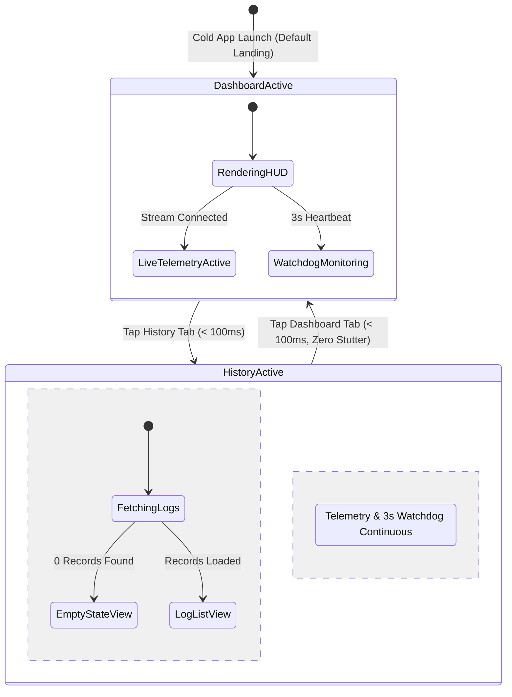

# Data Model: Navigation Shell & Tab Routing

**Feature**: Navigation Shell & Tab Routing (Dashboard & History)  
**Branch**: `002-navigation-shell`  
**Date**: 2026-11-24  
**Spec Reference**: [spec.md](./spec.md)

---

## 1. Domain Entities & Presentation State

### 1.1 Navigation Route (`NavigationRoute`)
Represents an accessible top-level destination configured in the navigation shell.

| Field | Type | Description | Validation / Constraints |
|---|---|---|---|
| `name` | `'index' \| 'history'` | Unique Expo Router route identifier | Must match file in `app/(tabs)/` |
| `title` | `string` | Human-readable screen title for header & tab bar | Non-empty string (`'Dashboard'` or `'History'`) |
| `iconSymbol` | `string` | Tactical Unicode glyph representing the route | Non-empty tactical glyph (`'⌖'` or `'▤'`) |
| `isDefault` | `boolean` | Designates initial cold-start landing screen | Exactly one route has `isDefault: true` (`'index'`) |
| `href` | `string` | Navigation path string | Relative path (`'/'` or `'/history'`) |

---

### 1.2 Navigation Shell State (`NavigationShellState`)
Represents the runtime state of the navigation container and background telemetry status.

| Field | Type | Description | Constraints |
|---|---|---|---|
| `activeRoute` | `'index' \| 'history'` | Currently displayed tab screen | Must be valid route key |
| `isBackgroundStreamingActive`| `boolean` | Indicates active telemetry connection in background | True when `connectionState === 'Connected'` |
| `safeAreaInsets` | `EdgeInsets` | Device-specific display insets (top, bottom, left, right) | Derived from `react-native-safe-area-context` |

---

### 1.3 Flight History UI State (`FlightHistoryUiState`)
Represents the presentation state of the History screen, encapsulating the loaded flight summaries.

| Field | Type | Description | Validation / Constraints |
|---|---|---|---|
| `records` | `FlightRecordEntity[]` | Chronological list of completed flight summaries | Array of valid flight summary entities (most recent first) |
| `isLoading` | `boolean` | True while SQLite query is in-flight | Boolean flag |
| `errorMessage` | `string \| null` | Descriptive error if SQLite read fails | Non-empty string or null |
| `isEmpty` | `boolean` | Derived convenience flag | True if `records.length === 0` and `!isLoading` |

#### State Transitions for `FlightHistoryUiState`:
1. **Initial**: `{ records: [], isLoading: true, errorMessage: null, isEmpty: false }`
2. **Success (Populated)**: `{ records: [summary1, ...], isLoading: false, errorMessage: null, isEmpty: false }`
3. **Success (Empty)**: `{ records: [], isLoading: false, errorMessage: null, isEmpty: true }`
4. **Failure**: `{ records: [], isLoading: false, errorMessage: "Database read failed", isEmpty: false }`

---

### 1.4 Telemetry Context Contract (`TelemetryContextValue`)
Provides shared presentation access to the running `TelemetryDashboardController` across the tab layout shell.

| Field / Method | Type | Description |
|---|---|---|
| `connectionState` | `ConnectionState` | `'Connecting' \| 'Connected' \| 'Disconnected' \| 'Error'` |
| `telemetry` | `DroneTelemetry \| null` | Latest received telemetry packet or retained stale packet |
| `isStale` | `boolean` | True when 3s watchdog has expired and data is frozen |
| `breadcrumbs` | `BreadcrumbPoint[]` | In-memory GPS coordinates trail |
| `errorMessage` | `string \| null` | Error description if connection failed |
| `connect` | `() => void` | Initiates connection & arms 3-second watchdog timer |
| `disconnect` | `() => void` | Disconnects & disarms watchdog |
| `clearBreadcrumbs`| `() => void` | Resets in-memory coordinate trail |
| `controller` | `TelemetryDashboardController` | Reference to persistent controller instance |

---

## 2. Validation & Business Constraints

1. **FR-003 / SC-003 (Cold Start Landing)**: Cold launches must land on `index.tsx` (Dashboard). The router configuration must define `initialRouteName="index"`.
2. **FR-004 / SC-001 (Transition Latency)**: Tab switches must not re-mount or destroy the underlying tab shell, maintaining transition latency `< 100ms`.
3. **FR-006 / SC-002 (Watchdog Continuity)**: The `TelemetryDashboardController` must remain alive in `TelemetryProvider` at the `(tabs)/_layout.tsx` level; navigating to `history.tsx` MUST NOT trigger `controller.dispose()`.
4. **FR-008 (Empty State)**: When `FlightHistoryUiState.isEmpty === true`, the screen must render a tactical empty state banner with label `"No flight logs recorded"`.
