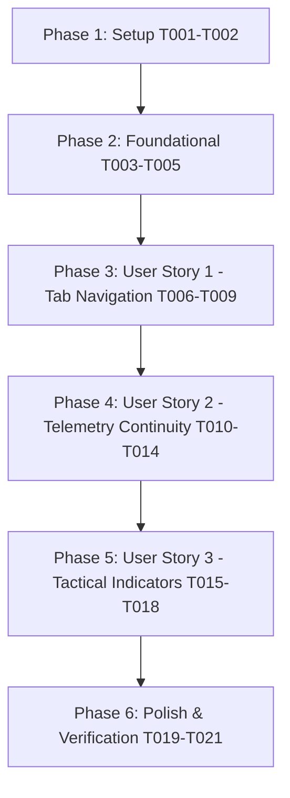

# Tasks: Navigation Shell & Tab Routing (Dashboard & History)

**Input**: Design documents from `specs/002-navigation-shell/`  
**Prerequisites**: [plan.md](./plan.md) (required), [spec.md](./spec.md) (required), [data-model.md](./data-model.md), [contracts/](./contracts/), [research.md](./research.md), [quickstart.md](./quickstart.md), [.specify/memory/constitution.md](../../.specify/memory/constitution.md)

**Tests**: Tests are mandatory per Constitution Principle V ("Automated tests MUST be 100% deterministic") and verification gates. Deterministic test tasks are included for each user story and must use fake timers (`jest.useFakeTimers()`) and controllable fakes (`FakeTelemetrySource`, `FakeFlightRecordDao`).

**Organization**: Tasks are grouped by user story to enable independent implementation and testing of each story.

## Format: `- [ ] [ID] [P?] [Story?] Description with file path`

- **[P]**: Can run in parallel (different files, no dependencies)
- **[Story]**: Which user story this task belongs to (e.g., [US1], [US2], [US3]). Omitted for Setup, Foundational, and Polish phases.
- Exact file paths are included in all task descriptions.

---

## Phase 1: Setup (Shared Infrastructure)

**Purpose**: Navigation route configuration, iconography, and baseline navigation shell constants.

- [X] T001 Define navigation route constants and tab options in `src/presentation/navigation/navigationRoutes.ts` citing constraints from `data-model.md` for `NavigationRoute.name`, `NavigationRoute.title`, `NavigationRoute.iconSymbol`, `NavigationRoute.isDefault`, and `NavigationRoute.href` conforming to `contracts/navigation-shell.contract.ts`
- [X] T002 [P] Implement tactical utilitarian tab icon glyph component `TabBarIcon` in `src/presentation/components/TabBarIcon.tsx` rendering high-contrast tactical symbols (`⌖` and `▤`) styled with active/inactive tints

---

## Phase 2: Foundational (Blocking Prerequisites)

**Purpose**: Presentation state models, history data hooks, and empty state UI components that MUST be complete before user stories can be integrated.

⚠️ **CRITICAL**: No user story work can begin until this foundational phase is complete.

- [X] T003 Define `FlightHistoryUiState` models and initial state in `src/presentation/state/FlightHistoryUiState.ts` citing constraints from `data-model.md` for `FlightHistoryUiState.records`, `FlightHistoryUiState.isLoading`, `FlightHistoryUiState.errorMessage`, and `FlightHistoryUiState.isEmpty` conforming to `contracts/flight-history.contract.ts`
- [X] T004 [P] Implement presentation hook `useFlightHistory` in `src/presentation/hooks/useFlightHistory.ts` fetching completed flight summaries from `FlightRecordDao` with empty state detection
- [X] T005 [P] Implement tactical empty state banner component `EmptyHistoryState` in `src/presentation/components/EmptyHistoryState.tsx` displaying `"No flight logs recorded"` per FR-008

**Checkpoint**: Foundation ready — user story implementation can now begin.

---

## Phase 3: User Story 1 - Primary Tab Navigation Between Live Dashboard and History (Priority: P1) 🎯 MVP

**Goal**: Operator can switch between Dashboard and History views via a persistent bottom navigation bar with sub-100ms transition latency; cold launches reliably land on Dashboard.

**Independent Test**: Mount tab layout in test harness, verify default route is Dashboard (`index`), navigate to History tab and assert History screen mounts, navigate back to Dashboard and assert Dashboard mounts within 100ms (FR-001, FR-002, FR-003, FR-004, SC-001, SC-003).

### Tests for User Story 1

> **NOTE: Write these tests FIRST and ensure they FAIL before implementing screen and layout wiring.**

- [X] T006 [P] [US1] Unit test for `useFlightHistory` hook states (loading, empty state, populated summaries, error) in `tests/unit/presentation/useFlightHistory.test.ts` using `FakeFlightRecordDao`
- [X] T007 [P] [US1] Unit test for tab route configuration and cold start default landing in `tests/unit/presentation/TabLayout.test.tsx`

### Implementation for User Story 1

- [X] T008 [US1] Implement primary History screen view in `app/(tabs)/history.tsx` rendering flight records or `EmptyHistoryState` via `useFlightHistory` with zero business logic per Constitution Principle II
- [X] T009 [US1] Configure Expo Router `<Tabs>` navigator in `app/(tabs)/_layout.tsx` connecting `index.tsx` (Dashboard) and `history.tsx` (History) with `initialRouteName="index"` citing constraints from `data-model.md` for `NavigationShellState.activeRoute`

**Checkpoint**: At this point, User Story 1 is fully functional and testable independently as an MVP.

---

## Phase 4: User Story 2 - Continuous Telemetry & State Preservation During Navigation (Priority: P2)

**Goal**: Telemetry connection, 3-second heartbeat watchdog timer, and live data stream persist uninterrupted across tabs; navigating away from Dashboard does not drop the stream or trigger false watchdog disconnects.

**Independent Test**: Connect to telemetry stream on Dashboard, switch to History tab for 10 simulated seconds while packets continue arriving, return to Dashboard: assert link remains `Connected`, watchdog timer did not fire, and metrics/breadcrumbs display all received packets immediately (FR-006, FR-007, SC-002, SC-005).

### Tests for User Story 2

> **NOTE: Write these tests FIRST and ensure they FAIL before implementing context wiring.**

- [X] T010 [P] [US2] Unit test for `TelemetryContext` and background stream persistence across screen mounts in `tests/unit/presentation/TelemetryContext.test.tsx` using `jest.useFakeTimers()` and `FakeTelemetrySource`

### Implementation for User Story 2

- [X] T011 [US2] Implement `TelemetryContext` and `TelemetryProvider` in `src/presentation/context/TelemetryContext.tsx` citing constraints from `data-model.md` for `TelemetryContextValue.connectionState`, `TelemetryContextValue.telemetry`, `TelemetryContextValue.isStale`, `TelemetryContextValue.breadcrumbs`, and `TelemetryContextValue.errorMessage` conforming to `contracts/telemetry-context.contract.ts`
- [X] T012 [P] [US2] Implement consumer hook `useTelemetryContext` in `src/presentation/hooks/useTelemetryContext.ts` exposing shared telemetry state and control actions
- [X] T013 [US2] Wrap `(tabs)/_layout.tsx` with `TelemetryProvider` to ensure single persistent controller lifecycle across tab transitions citing constraints from `data-model.md` for `NavigationShellState.isBackgroundStreamingActive`
- [X] T014 [US2] Update `app/(tabs)/index.tsx` to consume `useTelemetryContext` instead of locally owning controller lifecycle, preserving background monitoring across navigation

**Checkpoint**: User Stories 1 AND 2 work together independently; switching tabs keeps telemetry stream, watchdog, and recording active in the background.

---

## Phase 5: User Story 3 - Utilitarian Visual Indicators & Shell Ergonomics (Priority: P3)

**Goal**: High-contrast active tab indicator (`colors.metric.cyan`), subdued inactive tabs, safe area insets handling, and responsive card rendering for flight summaries.

**Independent Test**: Verify tab bar styling applies `colors.surface`, `colors.border`, active cyan tint, and safe area padding without clipping on devices with bottom gesture bars (FR-005, FR-009, SC-004).

### Tests for User Story 3

> **NOTE: Write these tests FIRST and ensure they FAIL before implementing appearance updates.**

- [X] T015 [P] [US3] Unit test for tab bar appearance options and safe area styling in `tests/unit/presentation/TabBarAppearance.test.ts`

### Implementation for User Story 3

- [X] T016 [US3] Configure tab bar styling in `app/(tabs)/_layout.tsx` applying `colors.surface`, `colors.border`, `colors.metric.cyan`, and safe area bottom insets citing constraints from `data-model.md` for `NavigationShellState.safeAreaInsets`
- [X] T017 [US3] Add tactical flight summary item card component `FlightHistoryCard` in `src/presentation/components/FlightHistoryCard.tsx` displaying duration, max altitude, average speed, and date in high-contrast utilitarian styling
- [X] T018 [US3] Integrate `FlightHistoryCard` list rendering with pull-to-refresh action in `app/(tabs)/history.tsx`

**Checkpoint**: All three user stories are complete, independently verifiable, and aesthetically unified with the Dark Mode First tactical theme.

---

## Phase 6: Polish & Cross-Cutting Concerns

**Purpose**: End-to-end verification, type checking, test suite execution, and documentation synchronization.

- [X] T019 [P] Update navigation documentation and component links in `specs/002-navigation-shell/quickstart.md`
- [X] T020 Run static type checking verification (`npm run typecheck`) across all modified screens and components
- [X] T021 Run complete automated Jest test suite (`npm test`) ensuring 100% pass rate with deterministic fake timers

---

## Dependencies & Execution Order

### Phase Dependencies

- **Setup (Phase 1)**: No dependencies — can start immediately.
- **Foundational (Phase 2)**: Depends on Setup completion — BLOCKS all user stories.
- **User Stories (Phase 3+)**: All depend on Foundational phase completion.
  - User Story 1 (P1): Can start immediately after Phase 2.
  - User Story 2 (P2): Depends on US1 layout wiring; can develop context components in parallel.
  - User Story 3 (P3): Depends on US1 and US2 screen/layout foundations.
- **Polish (Phase 6)**: Depends on all user stories being completed.

### User Story Dependencies



### Within Each User Story

- Test tasks ([P]) must be written and confirmed to fail before implementation tasks.
- Contracts and state types before hook and component implementation.
- Presentation hooks before screen integration.
- Screen integration before cross-screen state wiring.

### Parallel Opportunities

- **Phase 1**: `T002` (TabBarIcon) can run in parallel with `T001` (navigationRoutes).
- **Phase 2**: `T004` (useFlightHistory) and `T005` (EmptyHistoryState) can run in parallel with `T003`.
- **Phase 3 (US1)**: `T006` (useFlightHistory test) and `T007` (TabLayout test) can run in parallel.
- **Phase 4 (US2)**: `T010` (TelemetryContext test) and `T012` (useTelemetryContext hook) can run in parallel with `T011`.
- **Phase 5 (US3)**: `T015` (TabBarAppearance test) and `T017` (FlightHistoryCard component) can run in parallel.
- **Phase 6**: `T019` (quickstart doc update) can run in parallel with `T020`.

---

## Parallel Example: User Story 1

```bash
# Launch tests for User Story 1 together:
Task: "Unit test for useFlightHistory hook states in tests/unit/presentation/useFlightHistory.test.ts"
Task: "Unit test for tab route configuration in tests/unit/presentation/TabLayout.test.tsx"

# Implement screen and layout components:
Task: "Implement primary History screen view in app/(tabs)/history.tsx"
Task: "Configure Expo Router <Tabs> navigator in app/(tabs)/_layout.tsx"
```

---

## Implementation Strategy

### MVP First (User Story 1 Only)

1. Complete Phase 1: Setup (`T001`, `T002`).
2. Complete Phase 2: Foundational (`T003`, `T004`, `T005`).
3. Complete Phase 3: User Story 1 (`T006` through `T009`).
4. **STOP and VALIDATE**: Verify tab navigation connects Dashboard and History screens with `< 100ms` transition.
5. Review working tree; demonstrate viable MVP.

### Incremental Delivery

1. Setup + Foundational -> Foundation ready.
2. Add User Story 1 -> Test independently -> Tab navigation shell functional (MVP).
3. Add User Story 2 -> Test independently -> Background telemetry and 3s watchdog survive navigation.
4. Add User Story 3 -> Test independently -> High-contrast active indicators and safe area insets complete.
5. Polish -> Run full test suite and type check -> Clean verification gate.

---

## Notes

- **Checklist format**: All tasks strictly follow `- [ ] [TaskID] [P?] [Story?] Description with file path`.
- **Constraint Citations**: All 17 constrained fields from `data-model.md` are explicitly cited across implementing tasks (`T001`, `T003`, `T009`, `T011`, `T013`, `T016`).
- **Zero Business Logic in Screens**: `app/(tabs)/index.tsx` and `app/(tabs)/history.tsx` only render UI state and delegate actions to presentation hooks, strictly conforming to Constitution Principle II.
- **No Git Commits/Pushes**: All generated files remain in the working tree for user review per project governance rules.
