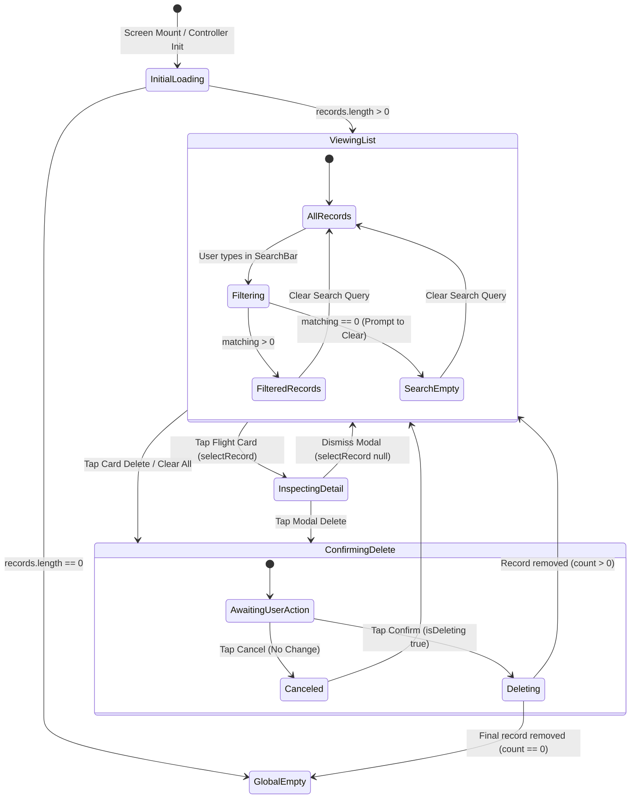

# Data Model: Flight History UI (Browse, Search, Inspect, Delete)

**Feature**: Flight History UI  
**Branch**: `003-flight-history-ui`  
**Date**: 2026-11-24  
**Spec Reference**: [spec.md](./spec.md)

---

## 1. Domain Entities & SQLite Entity

### 1.1 Flight Record (`FlightRecord`)
Represents the persistent summary entity defined in SQLite and consumed across the presentation layer (conforming to Constitution Principle IV).

| Field | Type | Description | Validation & Invariants |
|---|---|---|---|
| `id` | `string` | Unique flight identifier (UUID v4) | Non-empty string |
| `startTimeMillis` | `number` | Epoch timestamp when flight started | Integer > 0 |
| `endTimeMillis` | `number` | Epoch timestamp when flight ended | Integer >= `startTimeMillis` |
| `durationSeconds` | `number` | Total elapsed flight duration | Float >= 0.0 |
| `maxAltitudeMeters`| `number` | Peak altitude attained during flight | Float >= 0.0 |
| `averageSpeedMps`  | `number` | Average flight speed in meters per second | Float >= 0.0 |
| `minBatteryPercentage` | `number` | Lowest recorded battery level (0-100) | Float 0.0 <= value <= 100.0 |

---

## 2. Presentation State & UI Models

### 2.1 Flight History UI State (`FlightHistoryUiState`)
Represents the reactive presentation state maintained by `FlightHistoryController` and observed by the UI via `useFlightHistory`.

| Field | Type | Description | Invariants |
|---|---|---|---|
| `records` | `FlightRecord[]` | All flight summaries loaded from local SQLite | Sorted by `startTimeMillis DESC` |
| `searchQuery` | `string` | Current text filter query | Trimmed string; default `""` |
| `filteredRecords` | `FlightRecord[]` | Subset of `records` matching `searchQuery` | Equals `records` when `searchQuery === ""` |
| `selectedRecord` | `FlightRecord \| null` | Currently inspected record for detail modal | `null` when detail modal is closed |
| `isLoading` | `boolean` | True during initial load or pull-to-refresh | Boolean |
| `isDeleting` | `boolean` | True during asynchronous SQLite deletion | Disables redundant delete triggers |
| `errorMessage` | `string \| null` | Human-readable error message if operation fails | `null` when nominal |
| `isEmpty` | `boolean` | True when total `records.length === 0` | Triggers `EmptyHistoryState` |
| `isSearchEmpty` | `boolean` | True when `records.length > 0` but `filteredRecords.length === 0` | Triggers "No matching records" state |

---

### 2.2 Delete Confirmation Target (`DeleteTarget`)
Represents the pending deletion action awaiting explicit operator confirmation in `TacticalConfirmDialog`.

| Field | Type | Description |
|---|---|---|
| `type` | `'single' \| 'bulk'` | Indicates whether deleting one record or purging all |
| `recordId` | `string \| undefined` | Target record ID (defined when `type === 'single'`) |
| `recordSummary` | `string \| undefined` | Formatted flight date/duration for display in confirmation |
| `totalCount` | `number \| undefined` | Total records to be cleared (when `type === 'bulk'`) |

---

## 3. Search Matching Algorithm

Given a raw query string `Q` and record collection `R`:
1. If `Q.trim() === ""` then `filteredRecords = R`.
2. Normalize search term: `term = Q.trim().toLowerCase()`.
3. For each record `r`:
   - Calculate formatted start date string `dateStr` (e.g., `"nov 24, 2026, 03:15 pm"`).
   - Calculate ISO date string `isoStr` (e.g., `"2026-11-24"`).
   - Check if `r.id.toLowerCase().includes(term)` OR `dateStr.toLowerCase().includes(term)` OR `isoStr.includes(term)`.
4. Include matching records in `filteredRecords`, preserving chronological ordering.
5. Update `isSearchEmpty = (records.length > 0 && filteredRecords.length === 0)`.

---

## 4. Deletion Invariants & Post-Conditions

1. **Explicit Confirmation**: No record is removed from SQLite or memory without explicit confirmation dispatch.
2. **Atomic In-Memory & Storage Consistency**:
   - `deleteFlightRecord(id)` removes the record from SQLite via `FlightRecordDao`.
   - On success, `records` is filtered to exclude `id`.
   - `filteredRecords` is filtered to exclude `id`.
   - If `selectedRecord?.id === id`, `selectedRecord` is set to `null` to automatically close the detail modal.
   - If `records.length === 0`, `isEmpty` transitions to `true`.
3. **Rollback / Error Handling**: If SQLite delete throws an error:
   - State retains the record.
   - `errorMessage` is populated with a tactical error warning.
   - `isDeleting` resets to `false`.
