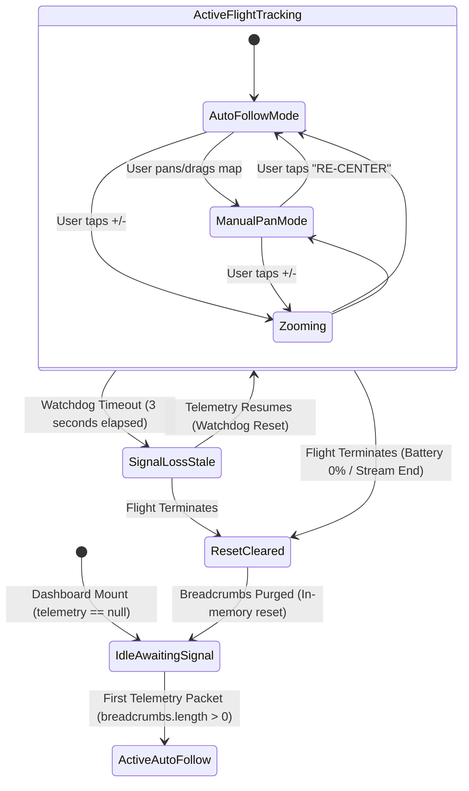

# Data Model: Tactical Map & Live Snail Trail Visualization

**Feature**: Tactical Map & Live Snail Trail Visualization  
**Branch**: `004-map-snail-trail`  
**Date**: 2026-11-24  
**Spec Reference**: [spec.md](./spec.md)

---

## 1. Domain Entities & Telemetry Types

### 1.1 Geographic Coordinate (`GeoCoordinate`)
Represents an earth-surface point in standard decimal degrees.

| Field | Type | Description | Invariants & Validation |
|---|---|---|---|
| `latitude` | `number` | WGS84 geographic latitude | `-90.0 <= latitude <= 90.0` |
| `longitude` | `number` | WGS84 geographic longitude | `-180.0 <= longitude <= 180.0` |

### 1.2 Transient Breadcrumb Point (`BreadcrumbPoint`)
Represents a recorded historical position retained strictly in transient memory during an active flight (Constitution Principle IV).

| Field | Type | Description | Invariants & Validation |
|---|---|---|---|
| `latitude` | `number` | Recorded geographic latitude | `-90.0 <= latitude <= 90.0` |
| `longitude` | `number` | Recorded geographic longitude | `-180.0 <= longitude <= 180.0` |
| `timestamp` | `number` | Epoch capture time in milliseconds | Integer > 0 |

### 1.3 Launch / Home Point (`HomePoint`)
Represents the mission origin point pinned at the first received GPS coordinate.

| Field | Type | Description | Invariants & Validation |
|---|---|---|---|
| `latitude` | `number` | Takeoff geographic latitude | Matches `breadcrumbs[0].latitude` |
| `longitude` | `number` | Takeoff geographic longitude | Matches `breadcrumbs[0].longitude` |
| `timestamp` | `number` | Epoch launch time in milliseconds | Matches `breadcrumbs[0].timestamp` |

---

## 2. Projection & Tactical Geometry Models

### 2.1 2D Screen Point (`ScreenPoint`)
Represents projected 2D coordinates within the map viewport coordinate space.

| Field | Type | Description | Invariants |
|---|---|---|---|
| `x` | `number` | Horizontal screen pixel position | `0 <= x <= viewportWidth` (when inside bounds) |
| `y` | `number` | Vertical screen pixel position | `0 <= y <= viewportHeight` (when inside bounds) |

### 2.2 Snail Trail Segment (`TrailSegment`)
Represents a rendered visual segment between two sequential breadcrumb coordinates.

| Field | Type | Description |
|---|---|---|
| `startIndex` | `number` | Index of origin breadcrumb in `breadcrumbs` array |
| `startPoint` | `ScreenPoint` | Screen coordinates of beginning node |
| `endPoint` | `ScreenPoint` | Screen coordinates of ending node |
| `distanceMeters` | `number` | Ground distance between points |

---

## 3. Viewport State & Lifecycle

### 3.1 Map Viewport State (`MapViewportState`)
Maintained by the presentation layer to manage camera positioning, zoom level, and tracking mode.

```typescript
export interface MapViewportState {
  /** Center geographic coordinate for the map canvas */
  centerCoordinate: GeoCoordinate | null;
  /** Zoom magnification multiplier (0.5 to 8.0, default 1.0) */
  zoomLevel: number;
  /** Ground meters represented by one screen pixel at current zoom */
  metersPerPixel: number;
  /** When true, viewport automatically follows the live drone coordinates */
  isAutoFollow: boolean;
  /** Pixel pan offset introduced by manual user dragging */
  panOffset: { x: number; y: number };
  /** Pixel dimensions of the tactical map component */
  viewportWidth: number;
  /** Pixel dimensions of the tactical map component */
  viewportHeight: number;
}
```

### 3.2 State Lifecycle & Transitions



---

## 4. In-Memory Boundaries (Constitution Principle IV)

- **Transient Only**: `BreadcrumbPoint[]` is stored solely in React/controller memory (`DashboardUiState.breadcrumbs`).
- **No Disk I/O**: Individual coordinates or trail points are **NEVER** written to SQLite.
- **Flight Conclusion**: When flight termination occurs, `clearBreadcrumbs()` empties the array to `[]`.
